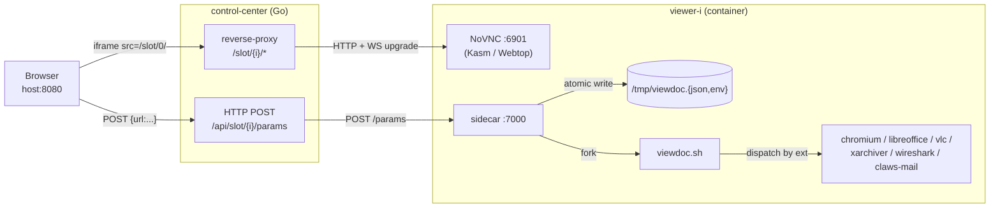

# AGENTS.md

## Goal

Remote streaming sandbox for **viewing files** (PDF, office docs, video, audio, images) in a browser-embedded iframe. Kasm / LinuxServer Webtop desktop containers fronted by a small **Go** control-center.

## Features

1. **Go stdlib.** Single static binary built on `net/http` + `httputil.ReverseProxy`.
2. **N slots, default 4** (2× Kasm + 2× Webtop, matching `docker-compose.yml`). Configured via `VIEWER_SLOTS` — comma-separated entries of the form `<vnc>[|<sidecar>]`. The vnc half accepts `http(s)://host[:port]`, plus two pseudo-schemes — `kasm://host[:port]` expands to `https://host:<VIEWER_KASM_DEFAULT_PORT>` (default `6901`), and `webtop://host[:port]` expands to `http://host:<VIEWER_WEBTOP_DEFAULT_PORT>` (default `3000`). The sidecar half accepts `http(s)://host[:port]`; when omitted, the sidecar inherits the vnc host on `VIEWER_SIDECAR_DEFAULT_PORT` (default `7000`). Mixed pools are first-class. See **README.md → Slot configuration** for worked examples.
3. **Plain HTTP inside, optional TLS outside.** Cleartext across the compose network (Kasm's own self-signed `:6901` is proxied with skip-verify). The control-center additionally serves TLS on `TLS_ADDR` (compose: `:8443`) (browsers need a secure context for clipboard access). `TLS_CERT` picks the cert (`internal/tlsself`): `embedded` (default — the pre-generated self-signed pair in `certs/server.{crt,key}`, regenerate via `make cert`), `generate` (on demand; persisted in `TLS_CERT_DIR`, extra SANs via `TLS_HOSTS`) or `file` (your own `TLS_CERT_FILE` + `TLS_KEY_FILE`). See README → *TLS certificate*.
4. **Static slot topology.** Slots declared in `docker-compose.yml` and discovered by DNS hostname on the compose network.
5. **HTTP sidecar for params.** Each viewer image runs a tiny sidecar on `:7000` by default (override per-slot in `VIEWER_SLOTS` or globally via `VIEWER_SIDECAR_DEFAULT_PORT`); control-center pushes params via `POST http://<sidecar-host>:<sidecar-port>/params`.
6. **Stateless slot selection.** Slot picked by `?slot=<i>` (default `0`) or `?slot=auto` (random ready slot).

## Architecture



## Control Center (API)

Listens on `:8080` (`LISTEN_ADDR`), plus TLS on `TLS_ADDR` when set.

| Method | Path                     | Purpose |
|--------|--------------------------|---------|
| GET    | `/`                      | Landing page with `<iframe>` viewer + JS bridge. |
| GET    | `/healthz`               | `{ready, total}` count of ready slots (VNC + sidecar up); 503 when none is ready. |
| GET    | `/api/slots`             | `{count, slots:[{idx, host, ip, path, vnc, sidecar, ready}]}`. `vnc` = VNC port accepts TCP, `sidecar` = sidecar `/healthz` returns 200 within 1s, `ready` = both. |
| POST   | `/api/slot/{i}/params`   | Forwarded verbatim to `<slot[i]>:7000/params`. |
| POST   | `/api/slot/{i}/restart`  | Forwarded to `<slot[i]>:7000/restart` (requires `Content-Type: application/json`). |
| GET    | `/api/slot/{i}/status`   | Relays `<slot[i]>:7000/status` (1s timeout); 502 when the sidecar is down. |
| ANY    | `/slot/{i}/*`            | Reverse proxy → `<slot[i]>:<novnc>` (HTTP + WS upgrade). |
| GET    | `/*`                     | Embedded UI assets from `web/` (`embed.FS`), e.g. `/app.js`, `/style.css`. |

## Sidecar (API)

Binds to `:7000` in every viewer image. No auth — compose network is the trust boundary.

| Method | Path        | Purpose |
|--------|-------------|---------|
| POST   | `/params`   | Validate, atomically write `/tmp/viewdoc.{json,env}`, fork `viewdoc.sh`. |
| GET    | `/healthz`  | Liveness — plain-text `ok`. |
| POST   | `/restart`  | Reply 202, exit 42. Kasm's `custom_startup.sh` / Webtop's s6 `finish` turn that into a container exit; the orchestrator restarts it (see README → *Restarting a slot*). |
| GET    | `/status`   | Latest request: `{phase, url, app, error, updated, app_state, exit_code}`. `phase` is `idle` (none since start), `queued` (set by the sidecar on `POST /params`), then `refused` / `deduped` / `downloading` / `failed` / `launched` from `viewdoc.sh` (via `/tmp/viewdoc.status`). For `launched` / `deduped`, `app_state` is `running` / `handoff` / `exited` from `/tmp/.viewdoc_last_state` (a dead `running` pid reads as `exited`). |

`POST /params` body: `{"params": {"<key>": "<value>", ...}}`. Sanitization (`internal/sanitize`, applied by both the control-center and the sidecar): key `^[A-Za-z][A-Za-z0-9_]{0,63}$`, ≤32 keys, ≤4096 bytes/value, no two keys equal after upper-casing (they'd map to the same `VIEWDOC_Q_*` variable), and `url` (any case) must be an absolute `http://` / `https://` URL with a host — apps get it as a bare argument, so anything else could be read as an option. `viewdoc.sh` repeats the http(s) check.

## Files (testing)

Sample URLs handy for poking each branch of `viewdoc.sh`. All serve the file directly (correct `Content-Type`, no HTML interstitial), so the VLC branch — which has no JS engine to follow a redirect — also works:

- PNG: <https://samplelib.com/lib/preview/png/sample-clouds-400x300.png>
- JPG: <https://samplelib.com/lib/preview/jpeg/sample-clouds-400x300.jpg>
- PDF: <https://www.w3.org/WAI/ER/tests/xhtml/testfiles/resources/pdf/dummy.pdf>
- DOCX: <https://calibre-ebook.com/downloads/demos/demo.docx>
- MP3: <https://samplelib.com/lib/preview/mp3/sample-3s.mp3>
- MP4: <https://samplelib.com/lib/preview/mp4/sample-5s.mp4>

Avoid `file-examples.com` URLs: that site gates downloads behind a 3-second JS redirect from `/wp-content/storage/…` to `/storage/<rotating-hash>/…`. Chromium and Firefox follow it; VLC and `curl` see only the HTML stub. The hash rotates, so hard-coding the post-redirect URL is fragile.

### How to verify each branch works

(Extension → application mapping lives in README.md's *File Types* table — don't duplicate it here.)

Drive the host page with agent-browser (`fill #url-input` + `click #url-form button[type=submit]`), then `screenshot` and check:

| Branch     | Pass criterion in the screenshot, plus dev notes                                                                                                                                                              |
|------------|---------------------------------------------------------------------------------------------------------------------------------------------------------------------------------------------------------------|
| Image      | Image visible, tab title matches filename, URL bar shows the `/storage/<hash>/…` URL after any interstitial.                                                                                                  |
| PDF        | Chromium's built-in PDF viewer (sidebar with page thumbnails); URL ends in `.pdf`.                                                                                                                            |
| Office     | LibreOffice window visible with the document loaded read-only (`soffice --view --norestore --nologo`).                                                                                                        |
| Media      | VLC window visible playing the media (`vlc --no-qt-privacy-ask --no-video-title-show`).                                                                                                                       |
| Archive    | Xarchiver window listing the archive contents. Download is synchronous inside the forked hook, capped at 60s — viewdoc.sh blocks on `curl` before launching the GUI.                                          |
| Capture    | Wireshark window open with the capture loaded (`wireshark -r <file>`); packet list visible.                                                                                                                   |
| Email      | Claws Mail main window with the message selected: headers + body + attachment icons in the message pane. viewdoc.sh rewrites a stub account + one-message MH mailbox in `/tmp/viewdoc-claws/` and runs `claws-mail --alternate-config-dir … --select <msg>` (a bare `file://` arg only works as the sole argument). Any running claws-mail is killed first. |
| Email (.msg) | Same Claws Mail window; `msgconvert` rewrites the Outlook file as `.eml` next to the download first. |
| Image (other) | Ristretto window showing the TIFF / HEIC / AVIF image. |
| Ebook      | Atril window with the first page rendered. |
| Text       | Mousepad window with the file contents. |
| 3D model   | F3D window rendering the model (software GL, so expect it to be slow on big meshes). |
| CAD        | LibreCAD window with the drawing. |
| Font       | GNOME Font Viewer showing the glyph preview. |
| Binary     | GHex window with the hex dump. |

When a file load looks broken, check in order:
1. `curl -sk <host>/api/slot/<i>/params -d '{"params":{"url":"…"}}'` returns `{"ok":true}` — proves the sidecar wrote `/tmp/viewdoc.{json,env}` and forked the hook.
   Then `curl -sk <host>/api/slot/<i>/status` says what the hook did (`refused`, `failed` + `error`, `launched` + `app_state`). The UI shows the same next to the buttons.
2. The browser/VLC window is *open* in the desktop — `viewdoc.sh` skips a URL equal to the last one (`/tmp/.viewdoc_last_url`) while that launch is still open: its process is alive, or it handed off to an already-running instance (exit 0 within 5s, e.g. a second Chromium/LibreOffice window). `/tmp/.viewdoc_last_state` holds `<pid> <running|handoff|exited>`. A failed download, a crash, or closing a VLC/Xarchiver/Wireshark window lets the same URL open again; a closed handed-off window can't be detected, so resubmitting that URL stays a no-op. Downloads land in unique `/tmp/viewdoc-dl.*` files, pruned after a day.
3. The slot's iframe is actually connected (KasmVNC shows "Connection Terminated: a new primary client connected" at the bottom when a fresh client takes over — that banner is normal, not an error).

### Known issue: KasmVNC primary-client lock

KasmVNC slots can wedge in "Connecting…" after a close/reopen from the same host — the previous primary client's lock isn't released cleanly on uncleanly-closed websockets. Symptom: even direct navigation to `https://<host>:<slot-port>/` hangs at the splash. Webtop slots recover by killing the old primary; KasmVNC slots may need a `docker compose restart viewer-kasm-*`. Worth investigating an idle-disconnect or force-takeover toggle.

### Clipboard sync

The iframe is created with `allow="autoplay; clipboard-read; clipboard-write; fullscreen"` (see `assets.go` / `app.js`), so noVNC's built-in clipboard channel can read/write the host clipboard. To verify by hand:

1. **Host → inner**: copy text on the host, focus the inner desktop (click into the iframe so noVNC gets keyboard focus), open the noVNC clipboard panel (or just Ctrl+V into an inner text field) — the host clipboard contents should appear.
2. **Inner → host**: select text inside the inner desktop, Ctrl+C, then read the host clipboard.

Headless agent-browser can't drive this end-to-end: mouse/keyboard events dispatched at the outer page don't reach the cross-origin noVNC canvas without prior focus, and `navigator.clipboard.read/writeText` from a script requires user activation. Use `--headed` (or a real browser) for clipboard validation.

## Browser testing (agent-browser)

For end-to-end checks use [`agent-browser`](https://github.com/agent-browser/agent-browser) — a CLI for headless/headed browser automation aimed at AI agents. It speaks Chrome via CDP, returns accessibility snapshots with stable `@refs`, and persists sessions through a daemon so commands can be chained with `&&`.

```bash
agent-browser open http://localhost:8080/
agent-browser snapshot -i                       # interactive elements only, with @refs
agent-browser eval "fetch('/api/slot/0/params', {method:'POST', headers:{'Content-Type':'application/json'}, body:JSON.stringify({params:{url:'https://example.com/x.pdf'}})}).then(r=>r.status)"
agent-browser screenshot ./out/slot0.png        # capture the iframe state
agent-browser get text @e1                      # read element text by ref
agent-browser console                           # browser console logs
agent-browser close --all
```

Useful flags: `--headed` to watch a run, `--session <name>` to isolate parallel runs, `--annotate` for vision-friendly screenshots, `--json` for machine-parseable output. Full command list: `agent-browser --help`; workflow patterns: `agent-browser skills get core --full`.

## What NOT to do

- ❌ No TLS between containers, no ACME / cert issuance, no openssl — the only TLS is the control-center's optional listener, with an embedded, generated or operator-supplied cert (`TLS_CERT`).
- ❌ No `/var/run/docker.sock`, no `docker exec`, no docker-cli inside any container.
- ❌ No dynamic slot spawning at runtime.
- ❌ No pool leasing / session IDs / TTL logic.
- ❌ No auth, rate limiting, DB.

## Resources

- **Kasm Workspaces** — streaming containerized desktops, NoVNC on `:6901`. <https://www.kasmweb.com/> · images: <https://hub.docker.com/u/kasmweb> · <https://github.com/kasmtech/workspaces-images>
- **LinuxServer Webtop** — alternative containerized desktop, NoVNC on `:3000`. <https://docs.linuxserver.io/images/docker-webtop/> · <https://github.com/linuxserver/docker-webtop>
- **NoVNC** — HTML5 VNC client over WebSockets (the protocol the reverse-proxy upgrades). <https://github.com/novnc/noVNC>
- **Go** — control-center language/runtime. <https://go.dev/>
